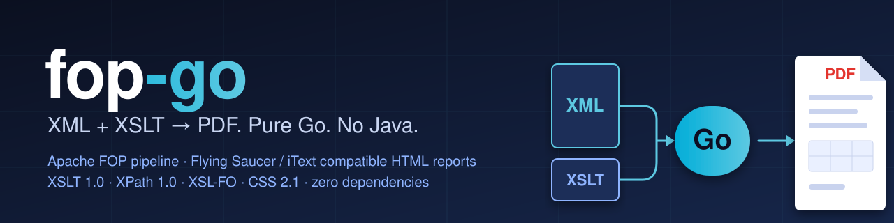

<p align="center">
  
</p>

<p align="center">
  <a href="https://github.com/ProDGG/fop-go/actions/workflows/ci.yml"></a>
  <a href="https://pkg.go.dev/github.com/ProDGG/fop-go"></a>
  
  <a href="LICENSE"></a>
  
   
</p>

# fop-go

**Apache FOP и Flying Saucer на чистом Go**: `XML + XSLT → XSL-FO / HTML → PDF`. Одна библиотека и один
бинарник вместо JVM: без Java, без cgo, без внешних зависимостей (только стандартная библиотека).

| | |
|---|---|
| **Два движка** | XSL-FO по конвейеру Apache FOP и HTML/CSS по конвейеру Flying Saucer 9.1.22 + iText 5 — выбирается автоматически по результату XSLT |
| **Совпадение с оригиналом** | вёрстка проверяется против настоящих FOP и Flying Saucer: позиции текста, базовые линии, разбиение на страницы, растр страниц |
| **Всё своё** | XML DOM, XPath 1.0, XSLT 1.0, разбор и подмножества TrueType, вёрстка, PDF-писатель |
| **Быстро** | отчёт на 67 страниц (XML + XSLT → PDF) около 0,4 с, потокобезопасно |
| **Кириллица из коробки** | встроены метрически-совместимые шрифты Liberation, текст в PDF копируется и ищется |

```
data.xml ──┐
           ├─ XSLT 1.0 ─▶ XSL-FO ─▶ вёрстка ─▶ PDF
template.xsl ┘            └─ HTML ─▶ CSS-вёрстка ─▶ PDF
```

```
go install github.com/ProDGG/fop-go/cmd/fop-go@latest
fop-go -xml data.xml -xsl template.xsl -pdf out.pdf
```

## Быстрый старт

CLI (по аналогии с `fop -xml … -xsl … -pdf …`):

```sh
go run ./cmd/fop-go -xml examples/invoice/invoice.xml -xsl examples/invoice/invoice.xsl -pdf invoice.pdf
go run ./cmd/fop-go -fo examples/features/features.fo -pdf features.pdf     # готовый XSL-FO
go run ./cmd/fop-go -xml d.xml -xsl t.xsl -pdf out.pdf -foout out.fo -param title=Отчёт
```

Библиотека:

```go
import fop "github.com/ProDGG/fop-go"

err := fop.RenderFiles("data.xml", "template.xsl", "out.pdf", fop.Options{
    Params: map[string]string{"company": "ООО «Ромашка»"},
    Warn:   func(s string) { log.Println(s) },
})

// или с потоками:
err = fop.Render(xmlReader, xslReader, pdfWriter, fop.Options{})
// только преобразование XML+XSLT → XSL-FO:
foTree, err := fop.Transform(xmlReader, xslReader, fop.Options{})
// готовый XSL-FO → PDF:
err = fop.RenderFO(foReader, pdfWriter, fop.Options{})
```

Параметры `Options`: `BaseDir` (для относительных путей картинок), `XSLBase` (для
`xsl:include`/`xsl:import`/`document()`), `Params` (xsl:param), `Fonts`/`FontDirs`
(дополнительные TTF), метаданные (`Title`, `Author`, …), `NoCompress`, `SourceResolution`
(dpi для `px`), `AllowRemote` (http(s)-картинки), `MaxPages` (лимит страниц, по умолчанию
100 000; при превышении — `fop.ErrPageLimit`), `Warn`.

## Шаблоны из `fs.FS` (embed)

Шаблоны можно вшить в бинарник (`embed.FS`) или читать из любой другой `fs.FS` (`os.DirFS`, `fstest.MapFS`,
архив). Шаблон читается из `fs.FS`, а XML приходит из `io.Reader` — удобно для HTTP-сервиса, у которого
весь отчёт лежит в одном исполняемом файле.

```
templates/
  IndividualAdvancedReport.xslt      ← <xsl:import href="PATH_TO_FILE/items/Header.xsl"/>
  items/Header.xsl
  images/logo.png                    ← 
```

```go
import (
    "bytes"
    "embed"
    "net/http"

    fop "github.com/ProDGG/fop-go"
)

//go:embed templates
var tpl embed.FS

// создаётся один раз на процесс: шаблоны компилируются при первом обращении и кэшируются
var reports = fop.NewTemplates(tpl, fop.Options{SourceRoot: "Root"})

func init() {
    // необязательно: ошибки в шаблонах — при старте, а не на первом запросе
    if err := reports.Compile("templates/IndividualAdvancedReport.xslt"); err != nil {
        panic(err)
    }
}

func handler(w http.ResponseWriter, r *http.Request) {
    var buf bytes.Buffer // сначала в буфер, чтобы при ошибке отдать 500, а не обрезанный PDF
    if err := reports.Render("templates/IndividualAdvancedReport.xslt", r.Body, &buf); err != nil {
        http.Error(w, err.Error(), http.StatusInternalServerError)
        return
    }
    w.Header().Set("Content-Type", "application/pdf")
    w.Write(buf.Bytes())
}
```

| Вызов | Что делает |
|---|---|
| `fop.NewTemplates(fsys, opts)` | рендерер для шаблонов из `fsys`; `opts` действуют для всех вызовов (шрифты, `SourceRoot`, `Params`, `MaxPages`, …) |
| `t.Render(имя, xml, w)` | XML из `io.Reader` → PDF в `io.Writer`; шаблон может выдавать и XSL-FO, и HTML |
| `t.WithParams(map[string]string{…})` | копия с другими `xsl:param`; кэш шаблонов общий |
| `t.Compile(имена…)` | компилирует и кэширует шаблоны заранее |
| `fop.RenderFS(fsys, имя, xml, w, opts)` | разовый вызов без кэша |

**Как разрешаются пути**

* Имя шаблона — путь через `/` внутри `fs.FS` (`"templates/A.xslt"`, не `"./A.xslt"` и не путь ОС).
* `xsl:import`, `xsl:include` и `document()` отсчитываются от каталога шаблона, который на них ссылается;
  `PATH_TO_FILE` подменяется на `.`, как и в обычном режиме. Ссылка выше корня `fs.FS` (`../…`) — ошибка.
* Картинки (``, `fo:external-graphic`) ищутся сначала относительно каталога шаблона, затем от корня
  `fs.FS`. `data:`-URI работают всегда; `http(s)` — только с `Options.AllowRemote`.
* Шрифты в `fs.FS` не ищутся: подключайте их через `Options.Fonts`, хоть из того же `embed`:

  ```go
  //go:embed fonts/arial.ttf fonts/arialbd.ttf
  var fonts embed.FS

  arial, _ := fonts.ReadFile("fonts/arial.ttf")
  arialBold, _ := fonts.ReadFile("fonts/arialbd.ttf")
  opts := fop.Options{
      SourceRoot: "Root",
      Fonts: []fop.FontSpec{
          {Family: "Arial", Data: arial},
          {Family: "Arial", Data: arialBold, Weight: 700},
      },
  }
  ```

**Параллельность.** `Templates` безопасен для одновременных вызовов (проверено `go test -race`): скомпилированный
шаблон только читается, а всё состояние рендера создаётся заново на каждый вызов.

**Тесты без файлов.** Подставьте `fstest.MapFS` — шаблоны, XML и картинки прямо в коде теста:

```go
fsys := fstest.MapFS{"t.xsl": {Data: []byte(`<xsl:stylesheet …>…</xsl:stylesheet>`)}}
err := fop.RenderFS(fsys, "t.xsl", strings.NewReader(`<r/>`), io.Discard, fop.Options{})
```

## Шрифты и кириллица

В бинарник встроены шрифты **Liberation** (SIL OFL; метрически совместимы с Arial/Helvetica,
Times и Courier; латиница, кириллица, греческий). Семейства `Helvetica`, `Arial`, `sans-serif`,
`Times`, `serif`, `Courier`, `monospace` и т. п. отображаются на них. Шрифты встраиваются в PDF
как CID TrueType-подмножества с `ToUnicode`, поэтому текст в PDF копируется и ищется.

Свои шрифты: `-font "Моя гарнитура=/path/font.ttf,bold,italic"` или `Options.Fonts`.
Системные каталоги шрифтов сканируются при обращении к неизвестному семейству и для подстановки
отсутствующих символов (отключается `-nosystemfonts`). Поддерживаются TrueType с контурами `glyf`
(`.ttf`); OpenType/CFF (`.otf`) не поддерживается.

## Что поддерживается

**XSLT 1.0**: шаблоны, режимы, приоритеты, `import`/`include`, `apply-templates`/`call-template`,
параметры и переменные (в т. ч. фрагменты результата как node-set), `for-each`, `choose`, `sort`,
`key()`, `document()`, `number`, `format-number`/`decimal-format`, `copy`/`copy-of`,
`element`/`attribute`, `attribute-set`, `namespace-alias`, `strip-space`, `message`,
упрощённые стилевые листы, часть функций XPath 2.0 (`upper-case`, `replace`, `matches`,
`ends-with`, `abs`, …) и `exsl:node-set`.

**XSL-FO**:
- страницы: `simple-page-master`, пять регионов, `page-sequence-master` (single/repeatable/
  alternatives с `first/last/rest`, чётность, blank), несколько колонок (`column-count`),
  `initial-page-number`, `force-page-count`, нумерация и форматы (`1`, `i`, `I`, `a`, `A`);
- блоки: `block`, `block-container` (абсолютное позиционирование, `reference-orientation`),
  `wrapper`, `inline` (фон, рамка, отступы, индексы), `basic-link`, `character`,
  `list-block`/`list-item` (`label-end()`, `body-start()`), `leader` (dots/rule/space/use-content);
- таблицы: фиксированные колонки (`proportional-column-width`, %, длины), `colspan`/`rowspan`,
  `border-collapse` (collapse/separate), повтор шапки и подвала на каждой странице, разрыв строк;
- вёрстка: выключка, `text-indent`, отступы/поля/рамки/фон, `space-before/after` со схлопыванием,
  `keep-together`, `keep-with-next/previous`, `orphans`/`widows`, `break-before/after`
  (page/column/odd-page/even-page), `white-space`, `text-transform`, `text-decoration`,
  `letter-spacing`, `line-height`, мягкие переносы, `display-align`;
- ссылки и навигация: `id`, `page-number`, `page-number-citation(-last)` (многопроходно),
  внутренние/внешние ссылки, `bookmark-tree` (оглавление PDF), `marker`/`retrieve-marker`;
- изображения: `external-graphic` (PNG с прозрачностью, JPEG, GIF; `scale-to-fit`, `content-width`,
  data-URI), фоновые изображения;
- `fo:footnote` и SVG (см. ниже); парное кернинг GPOS; точная целочисленная арифметика FOP
  (миллипункты);
- PDF: метаданные, Flate-сжатие, закладки, аннотации-ссылки.

## HTML-отчёты (Flying Saucer + iText)

Если результат XSLT — HTML-документ (корневой элемент `html`), PDF строится не FO-движком, а
портом конвейера **Flying Saucer 9.1.22 + iText 5.5** (`internal/xhr`), цель — вывод, совпадающий
с эталонным PDF, а не просто «похожий».

```
fop-go -xml report.xml -xmlroot Root -xsl templates/IndividualAdvancedReport.xslt -pdf report.pdf
fop-go ... -font "Arial=/path/arial.ttf" -font "Arial=/path/arialbd.ttf,bold"   # настоящий Arial
```

**Что реализовано:** CSS 2.1 (каскад UA < автор, `!important`, специфичность, `@page`, margin boxes,
`position: running()`, `counter(page|pages)`), блочная и строчная вёрстка (порт `BlockBoxing`,
`InlineBoxing`, `Breaker` с таблицами `BreakIterator` из JDK), float, таблицы (fixed/auto, collapsed
borders), позиционирование (`relative/absolute/fixed`, `z-index`, слои как в `Layer`), `overflow:
hidden`, постраничная разбивка, закладки (`h1..h6` из DOM, `<head><bookmarks>`), ссылки, PNG/JPEG/GIF,
SVG, минимальный однострочный `display:flex` (шапка отчётов).

**Как достигается совпадение с эталоном:**

* Метрики шрифтов как у iText: ascent/descent из `head`-bbox, целочисленные ширины глифов, округления
  `ITextTextRenderer`; базовые 14 шрифтов (Helvetica/Times/Courier) берут метрики и ширины из AFM iText.
* `Arial` по умолчанию — встроенный Liberation Sans с вертикальными метриками Arial (геометрия
  совпадает, форма букв чуть отличается). Для полного совпадения передайте настоящие `arial.ttf` /
  `arialbd.ttf` через `-font` / `Options.Fonts` (тогда подмена метрик не нужна).
* Числа в PDF форматируются как `ByteBuffer.formatDouble` iText, фоны вырезаются по clip как
  `java.awt.geom.Area`, порядок отрисовки (фон → float → текст → картинки → позиционированные слои) как в
  `Layer.paint`.
* SVG в `` растеризуется в антиалиасный битмап интринсик-размера (как в эталонном развёртывании);
  логотип 150×40 совпадает попиксельно.
* Растровые картинки `data:` декодируются строго как `java.util.Base64.getDecoder()` — перенос строки
  внутри base64 (как у QR-кода в шаблонах `personal`) отбрасывает картинку, как делает Flying Saucer.
* Результат XSLT сериализуется с `indent="yes"` и разбирается заново — так возвращается
  пробельный текст между элементами, который влияет на вёрстку.

**Опции:** `-xmlroot Root` (`Options.SourceRoot`) делает `Root` корнем входного XML (шаблоны обращаются
к `/Root/...`); `PATH_TO_FILE` в `xsl:import` заменяется на каталог шаблона (`Options.PathPlaceholder`).
`-maxpages N` (`Options.MaxPages`) прерывает вёрстку, если документу нужно больше N страниц —
защита от «разбухания» (например, гигантский размер шрифта из данных); `-version` печатает версию.

**Проверка:** тесты `internal/xhr` сравнивают позиции текста с выводом настоящего Flying Saucer на
синтетических фикстурах (`internal/xhr/testdata`, эталоны получены на оригинальной реализации).
`tools/xhrdev` рендерит HTML напрямую и может сохранить дамп дерева боксов
(`xhrdev in.html out.pdf boxes.txt`) для сравнения с Java.

**Известные отличия от эталонного PDF:** форма букв без настоящего Arial; блоки, версия шаблонов
которых в проде отличается от присланной; пробельные строки в margin-боксах не рисуются; нет
`-fs-table-paginate` (повтор `thead`), `border-radius`/`box-shadow` (во Flying Saucer 9.1.22 их тоже нет).

## Производительность

Замеры — обычные Go-бенчмарки (`go test -bench`), все воспроизводимы из репозитория, данные
синтетические:

```sh
go test . -run xxx -bench 'Invoice|FeaturesFO|HTMLSynthetic' -benchmem -count 6
go test ./internal/xhr -run xxx -bench Render -benchmem
```

Медиана из 5 запусков (`-benchtime 20x`), `goos: linux`, `goarch: amd64`, Intel Xeon @ 2.10GHz, 4 vCPU,
Go 1.24.7, шрифты встроенные (`NoSystemFonts`):

| Бенчмарк | Что делает | Страниц | Время/оп | Память/оп | Аллокаций/оп |
|---|---|---:|---:|---:|---:|
| `BenchmarkInvoice` | XML + XSLT → XSL-FO → PDF, счёт из `examples/invoice` | 1 | 6.3 ms | 3.3 MB | 27 тыс. |
| `BenchmarkFeaturesFO` | готовый XSL-FO, `examples/features` (оглавление, таблицы, колонки, картинки) | 15 | 60.4 ms | 52.5 MB | 254 тыс. |
| `BenchmarkHTMLSynthetic` | XML + XSLT → HTML → PDF, таблица на 1500 строк, нумерация страниц | 53 | 332 ms | 171 MB | 1.5 млн |

Большой отчёт на 67 страниц (реальные шаблоны XSLT, ~500 КБ HTML) целиком, от XML до PDF, занимает около
0.4–0.5 с на этой машине (примерно половина — XSLT, сериализация и повторный разбор HTML). Данные отчётов в репозиторий не входят, поэтому для него есть
только запускалка: `FOP_BENCH_XML=… FOP_BENCH_XSL=… go test . -run xxx -bench HTMLReport -benchmem`.

**Сравнение с Apache FOP 2.11** (тот же файл, та же машина; Apache FOP — Java 17+, настройки по умолчанию).
Честная картина зависит от режима, поэтому три замера:

| Документ | Режим | Apache FOP 2.11 | `fop-go` |
|---|---|---:|---:|
| `invoice` (1 стр.) | холодный запуск процесса, wall time | ≈ 0.9 с | ≈ 0.03 с |
| `features.fo` (15 стр.) | холодный запуск процесса, wall time | ≈ 1.2 с | ≈ 0.08 с |
| `invoice` | **прогретый JIT**, в процессе, медиана 200 прогонов после 300 разогревочных | ≈ 7.3 мс | **≈ 6.3 мс** |
| `features.fo` | **прогретый JIT**, в процессе, медиана 200 прогонов после 300 разогревочных | ≈ 65 мс | **≈ 60 мс** |
| `features.fo` | пиковая память процесса (RSS), один запуск | ≈ 179 МБ | ≈ 30 МБ |
| `invoice` | пиковая память процесса (RSS), один запуск | ≈ 114 МБ | ≈ 24 МБ |

Выводы без прикрас:

* **Холодный старт** (CLI, функции-обработчики, cron, контейнер на один документ): `fop-go` быстрее в 10–30 раз —
  нет запуска JVM и прогрева.
* **Прогретая JVM** (долгоживущий сервис, который собирает тысячи документов): на этих документах скорость
  одного порядка — у `fop-go` на 10–15% быстрее, но разница в пределах разброса и зависит от документа, так что
  честнее сказать «на уровне». Раньше `fop-go` уступал в 1.3–1.6 раза: главной причиной была медленная
  запись чисел в PDF (`strconv` на медленном пути) и повторное чтение встроенных шрифтов при каждом документе.
* **Память**: `fop-go` занимает в 5–6 раз меньше — важно для контейнеров с лимитами.
* Сравнение не идеально чистое: у Apache FOP по умолчанию нет кириллических шрифтов (он подставляет Times/Helvetica
  и сообщает об отсутствующих глифах, страниц в `features.fo` получается 14 вместо 15), а `fop-go` встраивает
  Liberation с подмножествами. Измерение «прогретого» режима делалось небольшой Java-программой, которая гоняет
  `FopFactory`/`Transformer` в одном процессе (в репозиторий она не входит — он остаётся чисто на Go).

Как это получено и что стоит учитывать:

* На коротких документах при холодном запуске доминирует старт процесса, поэтому разница там максимальна.
* `-benchmem` показывает суммарные аллокации за операцию, а не пиковую память: сборщик мусора освобождает их по
  ходу работы (около 20% времени уходит на него).
* Рендер потокобезопасен (общие кэши защищены, тест `TestConcurrentRender` проходит под `-race`), так что в
  сервисе документы можно собирать параллельно, по одному на горутину.

**Профилирование** — штатными средствами Go:

```sh
go test ./internal/xhr -run xxx -bench Render -cpuprofile cpu.out -memprofile mem.out
go tool pprof -top -cum cpu.out
```

**Что дало ускорение (HTML-движок в 2.5 раза, FO-движок в 1.3–1.9 раза)** (с 1.0–1.8 с до 0.4–0.5 с на отчёте из 67 страниц): индекс CSS-правил
по имени тега, общие объекты стилей для одинаковых элементов, пул deflate-компрессоров (уровень по умолчанию, как у
iText), разбор встроенных шрифтов один раз на процесс, пропуск поддеревьев вне видимой области при отрисовке
страницы и предвычисленные `strings.Replacer` (четверть всех аллокаций), быстрая запись чисел в потоки PDF без `strconv` с точным округлением (форматы проверены на 400 тыс. значений против прежней реализации) и общий для процесса набор встроенных шрифтов. Результат при этом не меняется: позиции
текста и растр страниц совпадают с прежними.

## Ограничения (чего пока нет)

- Автоматическая раскладка таблиц по содержимому (`table-layout="auto"`): колонки без ширины
  делят доступное место поровну (как и в FOP).
- Сносы слов по словарю (hyphenation), RTL/BiDi, сложное шейпирование (лигатуры, арабский,
  индийские письменности).
- `fo:footnote`: тела сносок размещаются внизу колонки с разделителем
  `xsl-footnote-separator`, но сноска не переносится по частям между страницами (FOP умеет);
  `fo:float`, `multi-switch` и другие интерактивные объекты; `fo:table-and-caption`
  (в самом FOP не реализован и отбрасывается).
- SVG (`instream-foreign-object`, `external-graphic` с `.svg`) — подмножество: фигуры, пути,
  линейные/радиальные градиенты, текст, трансформации, прозрачность, пунктир; без фильтров,
  масок, `clipPath`, паттернов и CSS-таблиц.
- Шифрование, PDF/A, PDF/UA (теги), вывод в форматы кроме PDF.
- Только горизонтальное письмо слева направо (`lr-tb`).

## Совместимость с Apache FOP

Движок вёрстки — переработка алгоритмов FOP 2.x (проверено сравнением с настоящим FOP 2.11):
- разбиение на строки — полный перенос Кнута–Пласса (`BreakingAlgorithm`, пороги 1/5/20,
  штрафы, демериты), элементы строк как в `TextLayoutManager`/`LineLayoutManager`;
- метрики шрифта по правилам FOP (OS/2 typo vs hhea, xHeight), интерлиньяж, сдвиг базовой
  линии, `space-before/after` со схлопыванием (`SpaceResolver`), отступы, keeps/orphans/widows,
  `force-page-count`, колонки, маркеры, сноски;
- повторяются и «ошибки» FOP: `keep-together` как шорткат запрещает перенос внутри строки,
  `text-transform="capitalize"` с off-by-one между текстовыми узлами, `empty-cells="hide"`,
  центрированные переносы, ширины блок-контейнеров как размеры содержимого и т. д.

На тестовых документах (`testdata/fidelity/*.fo`) совпадают разбиение на строки и страницы и
положение базовых линий (до 0.01pt); растровое отличие страниц — доли процента.
Инструменты на Go в `tools/` (Python не нужен): `go run ./tools/fidelity` (нужны Java и jar-файлы FOP
2.x в `$FOPLIBS`, poppler-utils) и `go run ./tools/pdfcmp {words|lines|baselines|texts|img} a.pdf b.pdf`
для сравнения двух PDF по словам, строкам, базовым линиям, позициям текста и пикселям. Таблицы
свойств `internal/fo/props_gen.go` пересоздаются командой `FOP_SRC=/path/to/xmlgraphics-fop go generate ./internal/fo`.

## Структура

| Пакет | Назначение |
|---|---|
| `xmldom` | DOM с пространствами имён, парсер (UTF-8, windows-1251, KOI8-R, ISO-8859-1/5), сериализатор |
| `xpath` | XPath 1.0 + паттерны XSLT |
| `xslt` | компилятор и исполнитель XSLT |
| `internal/font` | TTF: cmap, метрики, подмножество; менеджер шрифтов; встроенные Liberation |
| `internal/pdf` | запись PDF 1.7 |
| `internal/fo` | свойства FO, вёрстка, пагинация, рендер |
| `internal/xhr` | HTML/CSS-движок, совместимый с Flying Saucer + iText 5 |
| `internal/pdfscan` | разбор текстовых операций PDF (для сравнений и тестов) |
| `tools/xhrdev`, `tools/pdfcmp`, `tools/fidelity`, `tools/genprops` | отладка, сравнение PDF, сверка с FOP, генератор свойств |
| `cmd/fop-go` | командная строка |
| `java-service` | эталонный HTTP-сервис на Java (Flying Saucer 9.1.22 + iText 5.5.12): XML + XSLT → PDF, см. `java-service/README.md` |

Примеры: `examples/invoice` (XML+XSLT → счёт) и `examples/features` (многостраничный FO:
оглавление с лидерами, таблица на несколько страниц, колонки, изображения, маркеры).

## Лицензия

fop-go распространяется по **GNU LGPL 3.0 или более поздней версии** (`LICENSE`, `COPYING`).
Такая лицензия выбрана потому, что HTML-движок — перенос Flying Saucer (LGPL 2.1+), а FO-движок
перенимает части Apache FOP (Apache 2.0); LGPL 3.0 совместима с обеими. Происхождение
заимствованных частей — в `NOTICE`.

Что это значит на практике:

* использовать библиотеку и CLI в своих сервисах (в том числе закрытых и коммерческих) можно
  без ограничений — пока вы не распространяете программу, никаких обязательств нет;
* изменения самой fop-go при распространении нужно публиковать под той же лицензией;
* при распространении закрытой программы со встроенной fop-go получатель должен иметь
  возможность пересобрать её с изменённой fop-go (для Go — передать исходники или объектные
  файлы вашей части, либо вызывать `fop-go` как отдельный процесс).

Встроенные шрифты Liberation распространяются по SIL Open Font License 1.1
(см. `internal/font/data/LICENSE-Liberation.txt`).
